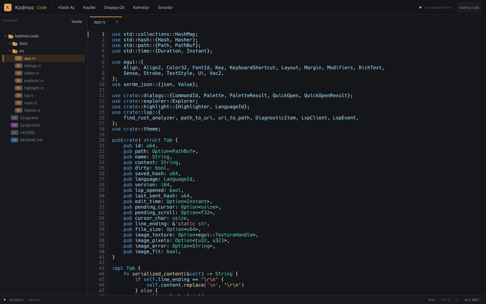

# Kodmoz Code

Rust ile yazılmış, VS Code'dan esinlenen minimal bir masaüstü IDE. Electron yok;
arayüz egui/eframe ile native çalışır. Rust dosyalarında tree-sitter tabanlı
sözdizimi vurgulama, `rust-analyzer` üzerinden LSP entegrasyonu ve görsel
dosyalar için salt okunur önizleme sunar.



## Özellikler

- Native pencere, VS Code benzeri koyu tema ve amber vurgulu Kodmoz arayüzü.
- Tembel yüklenen dosya gezgini: tam satır seçimi, dosya türü rozetleri,
  klasör aç/kapat, yenileme.
- Özel sekmeler: değişiklik noktası, hover'da kapatma, orta tıkla kapatma,
  kaydedilmemiş değişiklikler için onay penceresi.
- Editör: satır numaraları, aktif satır göstergesi, yumuşak sarma, undo/redo,
  kopyala/kes/yapıştır, UTF-8 ve UTF-16 LSP sütun dönüşümleri.
- tree-sitter ile Rust sözdizimi vurgulama (anahtar kelimeler, tipler,
  fonksiyonlar, makrolar, stringler, yorumlar, sayılar, lifetime'lar).
- LSP istemcisi (harici crate yok, stdio üzerinden JSON-RPC): `rust-analyzer`
  otomatik başlatılır, `didOpen`/`didChange`/`didClose` gönderilir, tanılamalar
  canlı toplanır.
- Sorunlar paneli: tüm dosyaların hata/uyarı/ipuçları, dosya:satır bilgisi ve
  tıklayınca ilgili konuma atlama.
- Durum çubuğu: hata/uyarı sayısı (tıklanınca paneli açar), Ln/Col, dil,
  kodlama, satır sonu ve git dalı.
- Görsel önizleme: PNG, JPEG, GIF, WebP, BMP, ICO ve TIFF dosyaları editörde
  metin olarak değil, sığdır/1:1 görüntüleyici olarak açılır. Saydamlık için
  dama deseni, boyut/dosya boyutu bilgisi ve salt okunur koruması vardır.
- İkili dosya koruması: NUL baytı içeren dosyalar metin olarak açılmaz; yanlış
  kodlama ile bozulmaz.
- Dosyaya Git (`Cmd+P`): `.gitignore`'a saygılı, fuzzy eşleşmeli hızlı açma.
- Komut paleti (`Cmd+Shift+P`) ve keşfedilebilir üst çubuk düğmeleri.
- CRLF satır sonlarını koruyarak kaydetme.
- Sürükle-bırak ile dosya/klasör açma.
- `Cmd+=` / `Cmd+-` ile yazı tipi yakınlaştırma.
- `KODMOZ_PROBLEMS=1` ortam değişkeniyle sorunlar paneli açık başlar.

## Kurulum

Gereksinimler:

- Rust (test edilen sürüm: 1.93)
- `rust-analyzer` (opsiyonel, önerilir):
  `rustup component add rust-analyzer`

Kaynaktan çalıştırma:

```bash
git clone https://github.com/hasanislamoglu5361/kodmoz-code.git
cd kodmoz-code
cargo run --release -- .
```

Yerel kurulum:

```bash
cargo install --path .
kodmoz-code /yol/proje
```

Kullanım biçimleri:

```bash
# Bir klasör aç
kodmoz-code /yol/proje

# Bir dosyayı aç (proje kökü Cargo.toml/.git aranarak bulunur)
kodmoz-code /yol/proje/src/main.rs

# Klasör + dosya
kodmoz-code /yol/proje /yol/proje/src/main.rs
```

İlk derleme eframe/egui ve grafik bağımlılıkları nedeniyle birkaç dakika
sürebilir. `rust-analyzer` bulunamazsa IDE çalışmaya devam eder; LSP durumu üst
çubukta gösterilir.

## Kısayollar

`Cmd`, macOS'ta Command; diğer platformlarda Ctrl anlamına gelir.

| Kısayol | İşlev |
| --- | --- |
| `Cmd+O` | Klasör aç |
| `Cmd+S` | Kaydet |
| `Cmd+Shift+S` | Farklı kaydet |
| `Cmd+N` | Yeni dosya |
| `Cmd+W` | Sekmeyi kapat |
| `Cmd+P` | Dosyaya git |
| `Cmd+Shift+P` | Komut paleti |
| `Cmd+B` | Kenar çubuğunu aç/kapat |
| `Cmd+Shift+M` | Sorunlar panelini aç/kapat |
| `Cmd+=` / `Cmd+-` | Yakınlaştır / uzaklaştır |

## Mimari

```
src/
  main.rs      CLI argümanları, proje kökü tespiti, pencere
  app.rs       uygulama durumu, paneller, kısayollar, LSP orkestrasyonu
  editor.rs    metin editörü + gutter; görsel önizleme; ikili dosya ekranı
  highlight.rs tree-sitter sorgusu ve egui LayoutJob üretimi
  lsp.rs       bağımlılıksız JSON-RPC/LSP istemcisi (stdio, thread + mpsc)
  explorer.rs  tembel yüklenen dosya ağacı ve özel satır çizimi
  dialogs.rs   hızlı dosya açma, komut paleti, fuzzy skor
  theme.rs     renk paleti ve ortak çizim bileşenleri
```

Veri akışı:

- UI egui ana thread'inde çalışır; LSP okuyucusu ayrı bir thread'de
  `Content-Length` çerçeveli mesajları okur ve `mpsc` ile UI'ya iletir.
- `rust-analyzer` bir alt süreç olarak Cargo projesinin kökünde başlatılır.
- Düzenlemeler 320 ms debounce ile tam metin `didChange` olarak gönderilir;
  `publishDiagnostics` bildirimleri dosya bazında saklanır.
- Sözdizimi vurgulama tüm belge için tree-sitter ile hesaplanır ve egui
  `LayoutJob` bölümlerine dönüştürülür.
- Görseller `image` crate ile çözülür, 8192 pikselden büyükse küçültülür,
  `ColorImage` üzerinden GPU dokusuna yüklenir ve `painter.image` ile çizilir.
  Bu nedenle görsel dosyaları asla metin tamponuna girmez.
- Gutter, egui'nin ürettiği galley satırlarından çizilir; sarma satırlarında
  mantıksal satır numarası korunur.

## Sınırlamalar

Bunlar bilinçli v0.1 sınırlarıdır:

- Eklenti API'si veya VS Code eklenti uyumluluğu yok.
- Hata ayıklama (DAP), terminal, git arayüzü ve bul/değiştir yok.
- Satır içi hata alt çizgileri yok; tanılamalar sorunlar panelinde gösterilir.
- Yalnızca Rust için otomatik dil sunucusu başlatılır.
- SVG önizlemesi yok; SVG metin olarak açılır.
- GIF/WebP animasyonları ilk kare olarak gösterilir.
- Yatay kaydırma yok; uzun satırlar yumuşak sarmalanır.
- Dosya izleyici yok; dışarıdan yapılan değişiklikler otomatik yüklenmez.
- Tek pencere / tek workspace.
- LSP tam metin senkronizasyonu kullanır (artımlı `didChange` değil).
- Editör tamponu şu an `String`; rope tabanlı özel çekirdek henüz yok.

## Yol haritası

1. Rope tabanlı editör çekirdeği, çoklu imleç, bul/değiştir.
2. Satır içi tanılama alt çizgileri ve hover bilgisi.
3. DAP ile hata ayıklama.
4. WASM eklenti konağı.
5. Gömülü terminal ve git durumu.
6. Dosya izleyici ve çoklu kök workspace.

## Neden Rust?

IDE'nin sıcak yolu (yazma, vurgulama, LSP trafiği) için GC duraklaması olmaması,
tree-sitter ve LSP ekosisteminin olgunluğu ve native arayüz imkânı belirleyici
oldu. Arayüz tarafında egui/eframe seçildi; böylece tüm uygulama tek dilde ve
webview olmadan çalışıyor.

## Lisans

MIT. Ayrıntılar için `LICENSE` dosyasına bakın.
