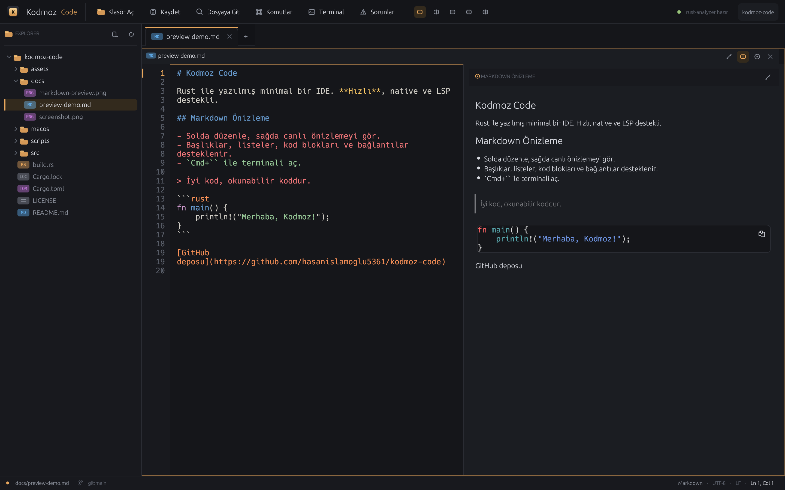

# Kodmoz Code

Rust ile yazılmış, VS Code'dan esinlenen minimal bir masaüstü IDE. Electron yok;
arayüz egui/eframe ile native çalışır. Rust dosyalarında tree-sitter tabanlı
sözdizimi vurgulama, `rust-analyzer` üzerinden LSP entegrasyonu ve görsel
dosyalar için salt okunur önizleme sunar.




## Özellikler

- Native pencere, VS Code benzeri koyu tema ve amber vurgulu Kodmoz arayüzü.
- Tembel yüklenen dosya gezgini: tam satır seçimi, dosya türü rozetleri,
  klasör aç/kapat, yenileme.
- Özel sekmeler: değişiklik noktası, hover'da kapatma, orta tıkla kapatma,
  kaydedilmemiş değişiklikler için onay penceresi.
- Editör: satır numaraları, aktif satır göstergesi, yumuşak sarma, undo/redo,
  kopyala/kes/yapıştır, UTF-8 ve UTF-16 LSP sütun dönüşümleri.
- Çok dilli sözdizimi vurgulama: Rust için tree-sitter; Shell, PHP, Swift,
  YAML, Terraform/HCL, Dockerfile, TOML, JSON, JavaScript, TypeScript, Python,
  Go, C/C++, Java, Kotlin, Ruby, Lua, SQL, HTML, CSS, XML, Markdown ve daha
  fazlası için syntect/two-face.
- Entegre terminal: gerçek PTY üzerinde `$SHELL` (zsh/bash), ANSI renkleri,
  imleç, kaydırma geçmişi, temizleme ve yeniden başlatma. `Cmd+`` veya
  `Cmd+J` ile açılır; panele tıklayıp komut yazabilirsiniz.
- Markdown görüntüleme: düzenleme, bölünmüş (solda editör / sağda canlı
  önizleme) ve yalnızca önizleme modları. Markdown dosyaları varsayılan olarak
  bölünmüş, HTML dosyaları önizleme modunda açılır; pane başlığındaki kalem /
  bölme / göz ikonlarıyla geçiş yapılır. Başlıklar, listeler, kod blokları,
  alıntılar ve bağlantılar render edilir.
- HTML önizleme: statik HTML → Markdown dönüşümü üzerinden başlık, paragraf,
  liste, kod ve bağlantıları gösterir. CSS/JavaScript çalıştırmaz.
- Çoklu dosya düzeni: tek bölme, iki sütun, iki satır, üç sütun veya 2x2
  dört bölme. Üst çubuktaki düzen ikonlarıyla seçilir; bölmeye tıklayınca
  odaklanır, sekme veya dosya gezgininden açılan dosya o bölmeye gelir.
- Satır içi tanılama: hatalı aralıkların altında kırmızı/sarı dalgalı çizgi,
  gutter'da hata noktası ve üzerine gelince hata mesajı.
- LSP istemcisi (harici crate yok, stdio üzerinden JSON-RPC): Cargo projesi
  açıldığında `rust-analyzer` otomatik başlatılır, `didOpen`/`didChange`/
  `didClose` gönderilir, tanılamalar canlı toplanır.
- Sorunlar paneli: tüm dosyaların hata/uyarı/ipuçları, dosya:satır bilgisi ve
  tıklayınca ilgili konuma atlama.
- Durum çubuğu: hata/uyarı sayısı (tıklanınca paneli açar), Ln/Col, dil,
  kodlama, satır sonu ve git dalı.
- Görsel önizleme: PNG, JPEG, GIF, WebP, BMP, ICO ve TIFF dosyaları editörde
  metin olarak değil, sığdır/1:1 görüntüleyici olarak açılır. Saydamlık için
  dama deseni, boyut/dosya boyutu bilgisi ve salt okunur koruması vardır.
- İkili dosya koruması: NUL baytı içeren dosyalar metin olarak açılmaz; yanlış
  kodlama ile bozulmaz.
- Dosyaya Git (`Cmd+P`): `.gitignore`'a saygılı, fuzzy eşleşmeli hızlı açma.
- Komut paleti (`Cmd+Shift+P`), ikonlu üst çubuk, gezgin ve panel
  düğmeleri; sol üstte uygulama logosu.
- CRLF satır sonlarını koruyarak kaydetme.
- Sürükle-bırak ile dosya/klasör açma.
- `Cmd+=` / `Cmd+-` ile yazı tipi yakınlaştırma.
- MacBook trackpad'de iki parmak pinch ile yazı boyutunu büyütme/küçültme;
  `Cmd+0` veya durum çubuğundaki `px` göstergesine tıklayarak 100%'e sıfırlama.
  Terminal yazı boyutu da bu ölçeğe uyum sağlar.
- `KODMOZ_PROBLEMS=1` ile sorunlar paneli, `KODMOZ_TERMINAL=1` ile terminal
  paneli açık başlar.

## Kurulum

Gereksinimler:

- Rust (test edilen sürüm: 1.93)
- `rust-analyzer` (opsiyonel, önerilir):
  `rustup component add rust-analyzer`

Kaynaktan çalıştırma:

```bash
git clone https://github.com/hasanislamoglu5361/kodmoz-code.git
cd kodmoz-code
cargo run --release -- .
```

Yerel kurulum:

```bash
cargo install --path .
kodmoz-code /yol/proje
```

macOS uygulaması olarak kurmak için (ikonlu `.app`):

```bash
./scripts/install-macos.sh
```

Script release derlemesini yapar, `Kodmoz Code.app` paketini ikonuyla oluşturur
ve `/Applications` altına kurar (yazılamıyorsa `~/Applications`). Kurulumdan
sonra Launchpad veya Spotlight'ten "Kodmoz Code" arayarak açabilirsiniz.

Kodmoz Code'u metin ve kaynak kod dosyaları için varsayılan editör yapmak
isterseniz:

```bash
./scripts/set-default-editor-macos.sh
```

Bu script LaunchServices üzerinden `public.text`, `public.plain-text`,
`public.source-code`, JSON, YAML, TOML, PHP, Python, Shell, C/C++, Swift,
Rust (`.rs`) ve Terraform (`.tf`, `.tfvars`, `.hcl`) gibi türleri Kodmoz
Code'a atar. `.txt`, `.rs`, `.php`, `.swift`, `.yaml`, `.toml`, `.tf`, `.json`,
`.sh`, `.py`, `.js`, `.tsx`, `.md` gibi uzantılar test edildi. Geri almak için
Finder'da bir dosyaya sağ tıklayıp **Bilgi Al → Birlikte Aç → Başka...** ile
başka bir uygulama seçip **Tümünü Değiştir** demeniz yeterlidir. Dosyalar çift
tıklandığında Apple Event (`odoc`) ile açılır.

macOS `.ts` uzantısını MPEG transport stream UTI'siyle eşlediği için `.ts`
video dosyaları da editörde açılır; video oynatmak için Finder'da `.ts` için
başka bir uygulama seçin. `.html` varsayılan olarak tarayıcıda bırakılır;
uzantısız `Dockerfile` sisteme `public.data` olarak göründüğü için otomatik
atanmaz (Open With ile açılabilir).

Kullanım biçimleri:

```bash
# Bir klasör aç
kodmoz-code /yol/proje

# Bir dosyayı aç (proje kökü Cargo.toml/.git aranarak bulunur)
kodmoz-code /yol/proje/src/main.rs

# Klasör + birden fazla dosya
kodmoz-code /yol/proje /yol/proje/src/main.rs /yol/proje/src/lib.rs

# 4 bölmeli düzenle başlat
KODMOZ_LAYOUT=4 kodmoz-code /yol/proje /yol/proje/src/main.rs /yol/proje/src/lib.rs /yol/proje/src/app.rs /yol/proje/src/ui.rs

# Markdown'ı bölünmüş görünümde aç
KODMOZ_PREVIEW=split kodmoz-code /yol/proje /yol/proje/README.md
```

`KODMOZ_LAYOUT` değerleri: `1`, `2c` (iki sütun), `2r` (iki satır), `3`,
`4`. `KODMOZ_PREVIEW` değerleri: `edit`, `split`, `preview`.

İlk derleme eframe/egui ve grafik bağımlılıkları nedeniyle birkaç dakika
sürebilir. `rust-analyzer` bulunamazsa IDE çalışmaya devam eder; LSP durumu üst
çubukta gösterilir.

## Kısayollar

`Cmd`, macOS'ta Command; diğer platformlarda Ctrl anlamına gelir.

| Kısayol | İşlev |
| --- | --- |
| `Cmd+O` | Klasör aç |
| `Cmd+S` | Kaydet |
| `Cmd+Shift+S` | Farklı kaydet |
| `Cmd+N` | Yeni dosya |
| `Cmd+W` | Sekmeyi kapat |
| `Cmd+P` | Dosyaya git |
| `Cmd+Shift+P` | Komut paleti |
| `Cmd+B` | Kenar çubuğunu aç/kapat |
| `Cmd+Shift+M` | Sorunlar panelini aç/kapat |
| `Cmd+`` / `Cmd+J` | Terminali aç/kapat |
| `Cmd+=` / `Cmd+-` | Yakınlaştır / uzaklaştır |
| `Cmd+0` | Yazı boyutunu sıfırla |

Bölme düzeni ve Markdown/HTML görünüm modları üst çubuk ve pane başlığındaki
ikonlardan seçilir.

## Mimari

```
src/
  main.rs      CLI argümanları, proje kökü tespiti, pencere
  app.rs       uygulama durumu, paneller, kısayollar, LSP orkestrasyonu
  editor.rs    metin editörü + gutter; tanılama çizgileri; görsel önizleme
  highlight.rs tree-sitter (Rust) + syntect/two-face (diğer diller)
  lsp.rs       bağımlılıksız JSON-RPC/LSP istemcisi (stdio, thread + mpsc)
  terminal.rs  portable-pty + vt100 tabanlı entegre terminal
  explorer.rs  tembel yüklenen dosya ağacı ve özel satır çizimi
  dialogs.rs   hızlı dosya açma, komut paleti, fuzzy skor
  theme.rs     renk paleti, ikonlar ve ortak çizim bileşenleri
  build.rs     macOS Apple Event köprüsünü derler
  macos/open_files.m  Finder'dan çift tıkla dosya açma (odoc)
```

Veri akışı:

- UI egui ana thread'inde çalışır; LSP okuyucusu ayrı bir thread'de
  `Content-Length` çerçeveli mesajları okur ve `mpsc` ile UI'ya iletir.
- `rust-analyzer` bir alt süreç olarak Cargo projesinin kökünde başlatılır.
- Düzenlemeler 320 ms debounce ile tam metin `didChange` olarak gönderilir;
  `publishDiagnostics` bildirimleri dosya bazında saklanır.
- Sözdizimi vurgulama Rust için tree-sitter, diğer diller için syntect ile
  hesaplanır ve egui `LayoutJob` bölümlerine dönüştürülür.
- Terminal, `portable-pty` ile gerçek bir PTY açar; `vt100` çıktıyı ekran
  hücrelerine ayrıştırır. Girişler PTY'ye, çıktı ayrı bir thread'de UI'ya
  aktarılır.
- Görseller `image` crate ile çözülür, 8192 pikselden büyükse küçültülür,
  `ColorImage` üzerinden GPU dokusuna yüklenir ve `painter.image` ile çizilir.
  Bu nedenle görsel dosyaları asla metin tamponuna girmez.
- Gutter, egui'nin ürettiği galley satırlarından çizilir; sarma satırlarında
  mantıksal satır numarası korunur.

## Sınırlamalar

Bunlar bilinçli v0.1 sınırlarıdır:

- Eklenti API'si veya VS Code eklenti uyumluluğu yok.
- Hata ayıklama (DAP), git arayüzü ve bul/değiştir yok.
- Terminal temel düzeydedir: metin seçimi/kopyalama ve çoklu terminal yok.
- HTML önizleme statiktir; CSS/JavaScript çalıştırmaz, tam tarayıcı değildir.
- Markdown önizleme görselleri yüklemez; metin, başlık, liste, kod ve
  bağlantılar gösterilir.
- Çoklu bölmeler eşit boyuttadır; bölmeler arasında sürüklenebilir ayırıcı
  yoktur (Markdown split görünümündeki ayırıcı sürüklenebilir).
- Yalnızca Rust için otomatik dil sunucusu başlatılır; diğer dillerde
  renklendirme vardır, LSP yoktur.
- SVG önizlemesi yok; SVG metin olarak açılır.
- GIF/WebP animasyonları ilk kare olarak gösterilir.
- Yatay kaydırma yok; uzun satırlar yumuşak sarmalanır.
- Dosya izleyici yok; dışarıdan yapılan değişiklikler otomatik yüklenmez.
- Tek pencere / tek workspace.
- LSP tam metin senkronizasyonu kullanır (artımlı `didChange` değil).
- Editör tamponu şu an `String`; rope tabanlı özel çekirdek henüz yok.

## Yol haritası

1. Rope tabanlı editör çekirdeği, çoklu imleç, bul/değiştir.
2. Satır içi tanılama alt çizgileri ve hover bilgisi.
3. DAP ile hata ayıklama.
4. WASM eklenti konağı.
5. Gömülü terminal ve git durumu.
6. Dosya izleyici ve çoklu kök workspace.

## Neden Rust?

IDE'nin sıcak yolu (yazma, vurgulama, LSP trafiği) için GC duraklaması olmaması,
tree-sitter ve LSP ekosisteminin olgunluğu ve native arayüz imkânı belirleyici
oldu. Arayüz tarafında egui/eframe seçildi; böylece tüm uygulama tek dilde ve
webview olmadan çalışıyor.

## Lisans

MIT. Ayrıntılar için `LICENSE` dosyasına bakın.
